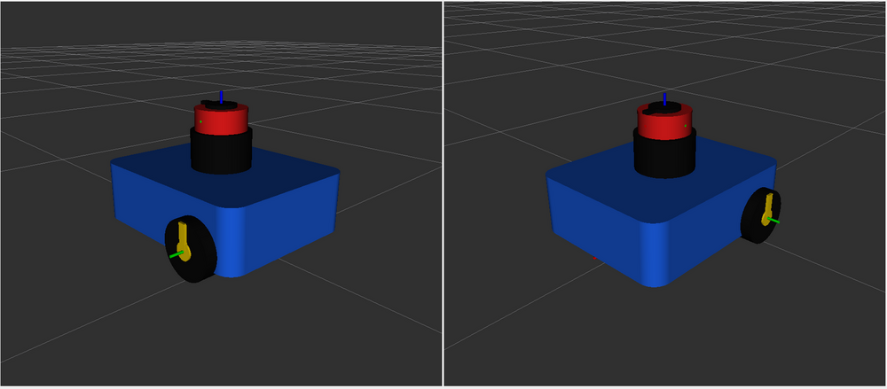

# ros2_ws — ROS 2 Humble cho robot amr_3wd (Wi-Fi, SLAM, Nav2)

Workspace chạy trên **Laptop Ubuntu 22.04 + ROS 2 Humble**, nói chuyện với ESP32
(`firmware_esp32/`) hoàn toàn qua Wi-Fi UDP.

| Package | Vai trò |
|---|---|
| `amr_description` | URDF/Xacro `amr_3wd.urdf.xacro` tham số hoá; `display.launch.py` (robot_state_publisher + RViz2 `robot_view.rviz`) |
| `amr_lidar_bridge` | Node Python nhận gói LiDAR UDP **8889** từ ESP32 → `/scan` (`sensor_msgs/LaserScan`, `frame_id = laser_frame`) |
| `amr_bringup` | `bringup.launch.py` (micro-ROS agent UDP **8888** + LiDAR bridge + URDF + RViz2), `slam.launch.py` (slam_toolbox), `navigation.launch.py` (Nav2) |

```
ESP32 ── UDP 8888 ──> micro_ros_agent ──> /odom, /tf (odom→base_footprint), /joint_states
      <──────────────────────────────────── /cmd_vel
ESP32 ── UDP 8889 ──> amr_lidar_bridge ──> /scan (laser_frame)
robot_state_publisher (URDF + /joint_states) ──> /tf: base_footprint→base_link→bánh xe, LiDAR
slam_toolbox (/scan + TF) ──> /map, map→odom        Nav2 (/map, /scan, TF) ──> /cmd_vel
```

## Mô hình robot (`amr_description`)



* Thân hộp bo góc 22 × 18 × 7 cm màu xanh dương, khoảng sáng gầm 1.5 cm.
* 2 bánh chủ động phía sau, bán kính 3.25 cm, cách nhau 18 cm (= `WHEEL_RADIUS_M`,
  `WHEEL_SEPARATION_M` của firmware), khớp `continuous` trục +Y (góc dương = lăn tới).
  Vạch vàng hướng kính trên mặt ngoài quay theo bánh → nhìn thấy bánh quay trong RViz.
* Bánh mắt trâu hình cầu màu bạc phía trước, chạm đất.
* LiDAR trụ đỏ/đen trên nóc; `laser_frame` là tâm mặt phẳng quét, cao **14 cm** so với đất.
  Mũi đen trên nắp chỉ hướng 0° của scan (trục x).
* Đủ `<visual>`, `<collision>`, `<inertial>` cho mọi link vật lý.

Cây TF:

```
odom                              (ESP32 /tf, 30 Hz)
└── base_footprint
    └── base_link                 (tâm trục bánh sau = tâm quay)
        ├── left_wheel_link       (continuous) └── left_wheel_marker_link
        ├── right_wheel_link      (continuous) └── right_wheel_marker_link
        ├── caster_wheel_link     (fixed)
        └── laser_frame           (fixed)      └── laser_mount_link
```

`*_marker_link` và `laser_mount_link` chỉ để tô màu: RViz2 Humble dùng material của
`<visual>` đầu tiên cho **mọi** visual trong một link, nên mỗi màu cần một link riêng.

Đổi kích thước khi chạy xacro, ví dụ `wheel_separation`, `wheel_radius`, `lidar_height`,
`lidar_x`, `lidar_yaw`:

```bash
xacro src/amr_description/urdf/amr_3wd.urdf.xacro lidar_height:=0.15 > /tmp/amr.urdf
```

## Cài đặt

Cần Ubuntu 22.04 + [ROS 2 Humble](https://docs.ros.org/en/humble/Installation/Ubuntu-Install-Debians.html).

```bash
sudo apt install ros-humble-desktop ros-humble-teleop-twist-keyboard python3-colcon-common-extensions python3-rosdep python3-vcstool
```

**micro-ROS agent** chưa có gói apt cho Humble — build từ source ngay trong workspace
(file `micro_ros_agent.repos`, CMake sẽ tải thêm Micro-XRCE-DDS-Agent từ GitHub):

```bash
cd ros2_ws
```

```bash
vcs import src < micro_ros_agent.repos
```

Cài phụ thuộc (slam_toolbox, Nav2, xacro, joint_state_publisher_gui…) rồi build:

```bash
sudo rosdep init   # chỉ lần đầu trên máy
```

```bash
rosdep update && rosdep install --from-paths src --ignore-src -r -y
```

```bash
colcon build --symlink-install
```

```bash
source install/setup.bash
```

Không muốn build agent? Bỏ bước `vcs import`; `bringup.launch.py` sẽ tự chạy Docker image
`microros/micro-ros-agent:humble` nếu máy có `docker` (người dùng cần thuộc nhóm `docker`).

Mở firewall cho ESP32 (Ubuntu):

```bash
sudo ufw allow 8888/udp && sudo ufw allow 8889/udp
```

## Chạy

### 1. Xem mô hình 3D (không cần robot)

```bash
ros2 launch amr_description display.launch.py preview:=true
```

`preview:=true` thêm `joint_state_publisher_gui` (thanh trượt quay bánh) và TF tĩnh
`odom → base_footprint`. Khi chạy với robot thật thì bỏ `preview` — bánh xe và tia LiDAR
trong RViz chạy theo `/joint_states`, `/tf`, `/scan` từ ESP32.

### 2. Khởi động robot (agent + LiDAR + URDF + RViz2)

Bật ESP32 (đã cấu hình `AGENT_IP` = IP Laptop) rồi:

```bash
ros2 launch amr_bringup bringup.launch.py
```

| Tham số | Mặc định | Ý nghĩa |
|---|---|---|
| `agent` | `auto` | `auto`: gói `micro_ros_agent` nếu có, không thì Docker · `ros` · `docker` · `none` (tự chạy agent riêng) |
| `agent_port` | `8888` | trùng `AGENT_PORT` trong `secrets.h` |
| `lidar_port` | `8889` | trùng `LIDAR_UDP_PORT` trong `robot_config.h` |
| `rviz` | `true` | mở RViz2 với `robot_view.rviz` (Fixed Frame `odom`: Grid, RobotModel, TF, LaserScan, Odometry) |

Kiểm tra và lái thử:

```bash
ros2 topic hz /scan
```

```bash
ros2 topic hz /odom
```

```bash
ros2 run teleop_twist_keyboard teleop_twist_keyboard --ros-args -p speed:=0.15 -p turn:=0.8
```

> Firmware dừng xe nếu không có `/cmd_vel` mới trong 500 ms: với teleop bàn phím hãy giữ phím.

Hiệu chỉnh bán kính bánh / khoảng cách 2 bánh từ `/odom` (đi thẳng rồi nhập quãng đường đo bằng
thước, hoặc quay tại chỗ rồi nhập số vòng thật — chi tiết ở README gốc, Bước 2.5):

```bash
ros2 run amr_bringup calibrate_odom
```

### 3. Quét bản đồ 2D (slam_toolbox)

```bash
ros2 launch amr_bringup slam.launch.py
```

Lệnh này đã gồm `bringup.launch.py` (thêm `bringup:=false` nếu bringup đang chạy ở terminal
khác) và mở RViz2 `slam.rviz` (Fixed Frame `map`, panel SlamToolbox). Lái chậm (≤ 0.2 m/s,
quay ≤ 0.5 rad/s) quanh khu vực, quay lại điểm xuất phát để đóng vòng lặp, rồi lưu bản đồ:

```bash
mkdir -p ~/maps && ros2 run nav2_map_server map_saver_cli -f ~/maps/amr_map
```

### 4. Dẫn đường tự động (Nav2)

Đặt robot tại **đúng chỗ bắt đầu quét bản đồ** (AMCL khởi tạo ở gốc `map`), rồi:

```bash
ros2 launch amr_bringup navigation.launch.py
```

Mặc định dùng `~/maps/amr_map.yaml`; bản đồ khác: `map:=/đường/dẫn/map.yaml`. Trong RViz2
(`navigation.rviz`):

1. Nếu robot không ở gốc bản đồ: **2D Pose Estimate** — bấm & kéo đúng vị trí, hướng thật.
2. **2D Goal Pose** hoặc **Nav2 Goal** — bấm & kéo tại điểm đích, xe tự lập đường và chạy.
3. Panel **Navigation 2**: theo dõi ETA, quãng đường còn lại, huỷ (Reset) hoặc đi qua nhiều điểm.

Vừa quét bản đồ vừa dẫn đường (không cần bản đồ có sẵn):

```bash
ros2 launch amr_bringup navigation.launch.py slam:=true
```

## Cấu hình chính

### Nav2 (`amr_bringup/config/nav2_params.yaml`) — tối ưu cho xe vi sai qua Wi-Fi

| Mục | Giá trị | Lý do |
|---|---|---|
| `transform_tolerance` | 0.5 s (AMCL, BT navigator, costmap, controller, behavior) | TF/odom qua Wi-Fi bị trễ, giật |
| Controller | Regulated Pure Pursuit, 10 Hz, 0.25 m/s, quay tại chỗ khi lệch > 45° | ít tham số, bám đường ổn định với robot vi sai nhỏ |
| `velocity_smoother` | 20 Hz, OPEN_LOOP, ≤ 0.30 m/s, ≤ 1.5 rad/s | gửi `/cmd_vel` đều (không dính timeout 500 ms của firmware), không phụ thuộc odom trễ |
| Footprint | hình tròn 0.21 m quanh `base_link` | phủ vùng thân xe quét qua khi quay quanh trục bánh sau |
| Costmap | lớp `obstacle_layer` 2D từ `/scan`, inflation 0.35 m | LiDAR 2D, robot nhỏ |
| AMCL | `DifferentialMotionModel`, laser 0.1–8 m, `set_initial_pose` tại gốc map | xe vi sai, LiDAR X2/Camsense |

### slam_toolbox (`amr_bringup/config/mapper_params_online_async.yaml`)

`base_frame: base_footprint`, `transform_timeout: 0.5` (Wi-Fi), tầm laser 0.12–8 m, độ phân giải
5 cm, thêm scan mới sau mỗi 0.2 m / 0.2 rad, cập nhật bản đồ mỗi 3 s.

### LiDAR bridge (`amr_lidar_bridge/config/lidar_bridge.yaml`)

| Tham số | Mặc định | Ý nghĩa |
|---|---|---|
| `udp_port` | 8889 | cổng nhận gói |
| `frame_id` | `laser_frame` | frame của `/scan` |
| `use_device_stamp` | `true` | dùng stamp ESP32 gửi kèm (đồng hồ đã đồng bộ với agent, nhất quán với `/odom`) |
| `max_stamp_skew` | 1.0 s | stamp lệch quá → dùng giờ nhận gói |
| `allowed_source_ip` | `""` | chỉ nhận từ IP này (nhiều robot cùng mạng) |
| `reliable_qos` | `true` | `/scan` reliable: tương thích mọi subscriber |

Định dạng gói "AMRL" v1: xem `firmware_esp32/README.md` hoặc `amr_lidar_bridge/packet.py`.

## Kiểm thử

```bash
colcon test && colcon test-result --verbose
```

76 test:

| Package | Test |
|---|---|
| `amr_lidar_bridge` (38) | giải mã gói LiDAR "AMRL" (fixture do bộ đóng gói C++ của firmware tạo, gói "vàng" mà firmware cũng giải mã, fuzz, mọi kiểu gói hỏng/cắt cụt), chuyển sang `LaserScan` và chọn stamp, node bridge nhận UDP thật → `/scan`, flake8, pep257 |
| `amr_description` (7) | cây TF, kích thước, quán tính, mỗi link một màu |
| `amr_bringup` (31) | launch file nạp được và không rò tham số, tham số Nav2/SLAM, footprint; **tên topic/frame thống nhất** giữa firmware ↔ URDF ↔ bridge ↔ slam_toolbox ↔ Nav2 ↔ RViz; thông số khớp firmware (bán kính & khoảng cách bánh, joint, cổng UDP, giới hạn vận tốc); toán của `calibrate_odom` |

## Xử lý sự cố

| Hiện tượng | Kiểm tra |
|---|---|
| Không có `/odom`, `/tf` | Agent đang chạy? Serial ESP32 báo `Da ket noi micro-ROS agent`? Firewall UDP 8888; `AGENT_IP` đúng IP Laptop |
| Không có `/scan` | Log `lidar_bridge` (cảnh báo không nhận gói), firewall UDP 8889, ESP32 Serial `lidar=OK` |
| RViz: `No transform from [left_wheel_link]` | Chưa nhận `/joint_states` (ESP32 chưa kết nối) — xem mô hình bằng `preview:=true` |
| Thấy node nhưng không thấy topic | `ROS_DOMAIN_ID` của Laptop phải trùng `ROS_DOMAIN_ID` trong `robot_config.h` (mặc định 0) |
| Bản đồ bị nhoè khi quay | Quay chậm hơn (LiDAR 5–7 Hz); kiểm tra `ros2 topic hz /scan` |
| Nav2 không chạy, báo chờ TF `map` | Chế độ AMCL: đặt **2D Pose Estimate**; kiểm tra `/scan` có dữ liệu |
| Xe không nhúc nhích khi có goal | Serial ESP32: trạng thái `FAILSAFE`/`FAULT`? `ros2 topic echo /cmd_vel` |
| Agent Docker không lên | Người dùng thuộc nhóm `docker` (`sudo usermod -aG docker $USER`, đăng nhập lại); container tên `amr_micro_ros_agent` tự dừng khi tắt launch, nếu còn sót: `docker stop amr_micro_ros_agent` |
| Laptop chạy WSL2 | Bật networking mode `mirrored` để ESP32 tới được agent và bridge |
