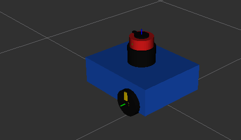

# Vẽ xe bằng FreeCAD rồi đưa vào URDF

Bạn vẽ hình dáng xe trong FreeCAD, xuất ra file **STL**, chép vào
`ros2_ws/src/amr_description/meshes/`, rồi chạy với `use_meshes:=true`. RViz sẽ hiện đúng chiếc xe
bạn vẽ.



## 0. Cách làm và lý do

URDF gồm hai phần khác nhau:

| Phần | Ai quyết định | Nằm ở đâu |
|---|---|---|
| **Hình dáng** (thân, bánh, LiDAR trông thế nào) | FreeCAD | `meshes/*.stl` |
| **Khung toạ độ và khớp** (tên link/joint, bán kính bánh, khoảng cách bánh, độ cao LiDAR) | Phải khớp firmware và Nav2 | `urdf/amr_3wd.urdf.xacro` |

Vì vậy repo **chỉ lấy hình dáng** từ FreeCAD. Tên `left_wheel_joint`, `laser_frame`,
`base_footprint`... vẫn giữ nguyên, nên firmware, LiDAR bridge, SLAM, Nav2 và các test tự động
chạy tiếp mà không phải sửa gì.

Chỉ `<visual>` dùng mesh. `<collision>` và `<inertial>` vẫn là hộp và trụ đơn giản: nhẹ, ổn định,
và Nav2 không cần va chạm chi tiết.

> Cũng có workbench **CROSS** (RobotCAD) xuất cả file URDF trực tiếp từ FreeCAD. Repo này không
> dùng cách đó, vì nó tự đặt tên link và joint, dễ lệch với firmware (`left_wheel_joint`…) và
> các file cấu hình Nav2.

Ba file cần vẽ:

| File | Gồm những gì | Màu trong RViz | Thay cho |
|---|---|---|---|
| `chassis.stl` | Thân xe và mọi thứ gắn cứng vào thân: tấm đế, motor, pin, giá đỡ, đế bánh mắt trâu. **Không** gồm bánh và LiDAR | xanh dương | hộp xanh |
| `wheel.stl` | **Một** bánh chủ động (bánh trái). Bánh phải dùng lại file này, xoay 180° | đen | trụ đen |
| `lidar.stl` | Phần thân LiDAR | đỏ | trụ đỏ |

STL không chứa màu. Màu lấy từ URDF, mỗi file một màu.

## 1. Quy ước toạ độ (quan trọng nhất)

FreeCAD dùng **mm**, và trục của FreeCAD trùng với trục của ROS:

* **+X** = phía trước xe (hướng xe chạy tới)
* **+Y** = bên trái xe
* **+Z** = hướng lên

**Gốc toạ độ (0,0,0) của từng file:**

| File | Gốc (0,0,0) đặt ở | Ghi chú |
|---|---|---|
| `chassis.stl` | **Trên mặt đất**, ngay dưới điểm giữa trục 2 bánh chủ động | Đáy thân xe ở Z = khoảng sáng gầm (vd 15 mm), không có phần nào âm Z |
| `wheel.stl` | **Tâm bánh** | Trục bánh theo **Y**, mặt ngoài (phía có moay-ơ/ốc) hướng **+Y** |
| `lidar.stl` | **Tâm mặt phẳng quét**: trên trục quay, ngang độ cao tia laser | Hướng tia 0° của LiDAR quay về **+X** |

Sai gốc toạ độ là lỗi hay gặp nhất: bánh quay lệch tâm, thân xe chìm dưới đất. Công cụ ở
[bước 4](#4-kiểm-tra-file-stl) phát hiện lỗi này.

## 2. Vẽ trong FreeCAD (1.0 trở lên)

Mỗi chi tiết vẽ thành **một Body riêng** trong workbench **Part Design**. Có thể để cả ba Body
trong cùng một file `.FCStd`.

Kích thước dưới đây là số mặc định của repo (bánh JGA25-370). Đo xe thật bằng thước kẹp rồi thay
số của bạn vào.

### 2.1. Bánh xe (`wheel`)

1. **Part Design → Create body**, đổi tên thành `wheel`.
2. **Create sketch**, chọn mặt phẳng **XZ_Plane** (vòng tròn nằm trong mặt XZ thì trục bánh là Y).
3. Vẽ hình tròn **tâm tại gốc**, đường kính **65 mm** (bán kính 32,5). Ràng buộc tâm trùng gốc
   bằng *Constrain coincident* với điểm gốc. Đóng sketch.
4. **Pad**, chiều dài **26 mm**, tích **Symmetric to plane** để bánh nằm đều hai bên gốc.
5. Có thể thêm gai lốp, nan hoa, lỗ trục (Pocket) và moay-ơ ở phía **+Y**. Lỗ trục phải nằm đúng
   tâm.

### 2.2. Thân xe (`chassis`)

1. **Create body** mới, đặt tên `chassis`.
2. Sketch trên **XY_Plane**. Gốc là điểm giữa trục 2 bánh. Ví dụ hình chữ nhật từ X = −50 tới
   X = 170 mm, Y = −90 tới 90 mm, tức dài 220 × rộng 180, tâm nằm trước trục bánh 60 mm.
3. Trong thuộc tính sketch, mục **Attachment Offset**, đặt Z = **15 mm** (khoảng sáng gầm).
4. **Pad 70 mm** (chiều cao thân).
5. Vẽ tiếp motor, giá pin, đế bánh mắt trâu... vào cùng Body này, hoặc làm Body riêng rồi gộp
   khi xuất (xem 3.2). **Chừa chỗ** cho bánh: hai bánh nằm ở Y = ±90 mm (± khoảng cách bánh / 2).

### 2.3. LiDAR (`lidar`)

1. **Create body** mới, đặt tên `lidar`.
2. Sketch trên **XY_Plane**: hình tròn tâm gốc, đường kính **60 mm**.
3. **Pad 25 mm, Symmetric to plane**: thân LiDAR cao 25 mm, gốc nằm ở giữa, đúng ngang tia
   laser.
4. Nên thêm một khối nhỏ ở phía **+X** (hướng 0°) để nhìn ra chiều lắp trong RViz.

Phần **trụ đỡ** từ nóc xe lên LiDAR không cần vẽ: URDF tự dựng trụ đen theo `lidar_height`. Nếu
bạn vẽ giá đỡ thật thì để nó trong `chassis`.

## 3. Xuất STL

### 3.1. Mỗi Body một file

1. Trong cây bên trái, chọn Body (ví dụ `wheel`).
2. **File → Export…**, chọn kiểu **STL Mesh (\*.stl)**.
3. Lưu đúng tên vào thư mục của repo, ghi đè file mẫu:
   ```
   ~/esp32-4wd-amr-ros2-humble/ros2_ws/src/amr_description/meshes/wheel.stl
   ~/esp32-4wd-amr-ros2-humble/ros2_ws/src/amr_description/meshes/chassis.stl
   ~/esp32-4wd-amr-ros2-humble/ros2_ws/src/amr_description/meshes/lidar.stl
   ```

Tên file phải viết thường đúng như trên.

### 3.2. Thân xe gồm nhiều Body, hoặc file quá nặng

Vào workbench **Mesh Design**, chọn tất cả Body thuộc thân xe, rồi dùng
**Meshes → Create mesh from shape…** (Standard, *Surface deviation* **0.1 mm**). Nếu nhiều mesh,
chọn hết rồi **Meshes → Boolean → Union**. Cuối cùng chọn mesh kết quả và
**Meshes → Export mesh…** → `chassis.stl`.

Nên giữ mỗi file **dưới khoảng 50 000 tam giác**. File quá mịn làm RViz giật mà không đẹp hơn.

> Nếu dùng phần mềm khác xuất STL theo **mét** (Blender, Onshape tuỳ cài đặt), chạy kèm
> `mesh_scale:=1.0`.

## 4. Kiểm tra file STL

Chạy trên laptop, không cần ROS:

```bash
cd ~/esp32-4wd-amr-ros2-humble/ros2_ws/src/amr_description
```

```bash
python3 scripts/stl_tool.py check meshes/chassis.stl meshes/wheel.stl meshes/lidar.stl
```

Kết quả tốt trông như sau:

```
meshes/wheel.stl: 384 tam giác
  kích thước X×Y×Z = 65.0 × 30.0 × 65.0 mm, tâm hộp bao = (0.0, 2.0, 0.0) mm
  bán kính bánh ≈ 0.03250 m -> wheel_radius trong URDF / WHEEL_RADIUS_M
  OK
```

Nếu có dòng **CẢNH BÁO**, quay lại FreeCAD sửa theo nội dung cảnh báo: sai đơn vị, tâm bánh lệch
gốc, bánh không tròn quanh trục Y, thân xe chìm dưới đất, hoặc quá nhiều tam giác.

Muốn quay về bộ hình mẫu thì chạy:

```bash
python3 scripts/stl_tool.py placeholders meshes/
```

## 5. Cập nhật kích thước trong URDF và firmware

Mesh chỉ là hình. Còn **bán kính bánh**, **khoảng cách bánh** và **độ cao LiDAR** dùng cho tính
toán odometry, SLAM và Nav2, nên phải khớp với hình bạn vẽ:

| Số đo trên bản vẽ | Sửa trong `urdf/amr_3wd.urdf.xacro` | Và trong `firmware_esp32/include/robot_config.h` |
|---|---|---|
| Bán kính bánh (`stl_tool` in ra) | `<xacro:arg name="wheel_radius" …>` | `WHEEL_RADIUS_M` |
| Khoảng cách tâm 2 bánh | `<xacro:arg name="wheel_separation" …>` | `WHEEL_SEPARATION_M` |
| Độ cao tia laser so với đất | `<xacro:arg name="lidar_height" …>` | – |
| Khoảng cách LiDAR tới trục bánh (theo X) | `<xacro:arg name="lidar_x" …>` | – |
| Kích thước thân (va chạm, quán tính) | `chassis_length/width/height`, `chassis_x_offset`, `chassis_clearance` | – |
| Vị trí bánh mắt trâu | `caster_x`, `caster_radius` | – |

Nếu thân xe đổi kích thước nhiều, sửa thêm **cả hai** dòng `robot_radius` (local và global
costmap) trong `amr_bringup/config/nav2_params.yaml`. Giá trị là khoảng cách từ `base_link` tới
điểm xa nhất của thân xe, cộng thêm 1–2 cm (mặc định 0.21 m).

`colcon test` sẽ báo lỗi nếu bánh trong `wheel.stl` lệch quá 1 mm so với `wheel_radius`, hoặc URDF
lệch với `robot_config.h`.

## 6. Build và xem trên RViz2

```bash
cd ~/esp32-4wd-amr-ros2-humble/ros2_ws
```

```bash
colcon build --symlink-install --packages-select amr_description
```

```bash
source install/setup.bash
```

Xem khi chưa có robot (thanh trượt để quay bánh):

```bash
ros2 launch amr_description display.launch.py preview:=true use_meshes:=true
```

Khi chạy robot thật:

```bash
ros2 launch amr_bringup bringup.launch.py use_meshes:=true
```

Lệnh này cũng dùng được với `slam.launch.py` và `navigation.launch.py`.

Muốn **luôn** dùng hình FreeCAD thì đổi mặc định trong `urdf/amr_3wd.urdf.xacro`:

```xml
<xacro:arg name="use_meshes" default="true"/>
```

Mỗi lần xuất lại STL, chạy lại `colcon build`. Nếu đã build với `--symlink-install` thì chỉ cần
tắt RViz rồi mở lại.

## 7. Lỗi thường gặp

| Hiện tượng | Nguyên nhân / cách sửa |
|---|---|
| Không thấy xe, hoặc xe to như toà nhà | Sai đơn vị: STL theo mét mà vẫn dùng `mesh_scale` 0.001 → thêm `mesh_scale:=1.0` |
| RViz báo `Could not load resource …/meshes/wheel.stl` | Sai tên file, hoặc chưa `colcon build` sau khi chép STL |
| Bánh quay lắc lư, lệch tâm | Tâm bánh không nằm ở gốc toạ độ (mục 1, `stl_tool check` báo) |
| Bánh nằm ngang như cái đĩa | Vẽ hình tròn trên XY thay vì **XZ** → trục bánh thành Z |
| Thân xe chìm xuống sàn, hoặc lơ lửng | Gốc của `chassis` không đặt ở mặt đất dưới trục bánh |
| Xe trong RViz quay ngược hướng chạy | Vẽ đầu xe về −X: xoay Body 180° quanh Z (Placement) rồi xuất lại |
| Cả xe một màu, muốn nhiều màu | STL không có màu; mỗi file một màu. Muốn thêm màu thì tách chi tiết thành link riêng (xem cách `*_marker_link` trong xacro) |
| Bản đồ SLAM méo, xe chạy sai quãng đường | Kích thước trong URDF/`robot_config.h` chưa khớp xe thật (mục 5), rồi hiệu chỉnh odometry (README chính, Bước 2) |
